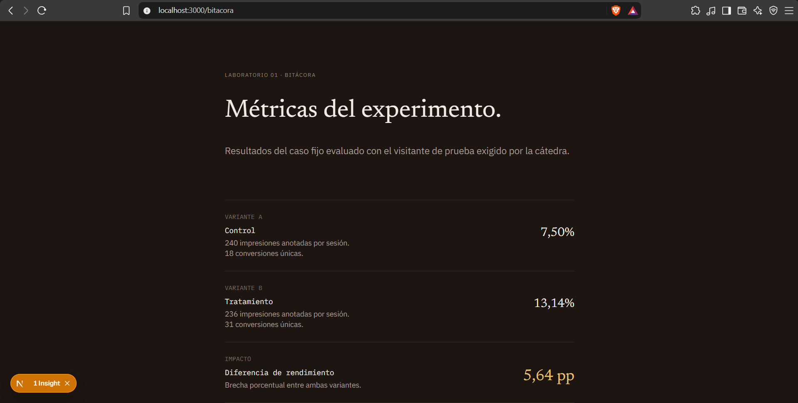

# Informe Técnico: Test A/B y SEO

**Alumno:** Thiago Nicolas Caselli  
**Carrera:** Licenciatura en Sistemas de Información (UADER FCyT)  

---

## 1. Análisis de Variantes
* **¿Qué ve una persona asignada a B?**  
  Una persona asignada a la variante B (Tratamiento) visualiza el titular *"El curso empieza el 14 de abril. El cupo, no."*, un botón de conversión (CTA) con el texto *"Reservar mi lugar"*, y metadatos SEO específicos en el servidor. La oferta comercial central (inicio el 14 de abril, duración de 8 semanas, cupo de 12 personas y oficios de carpintería, electricidad y cocina) se mantiene idéntica en ambas versiones.

* **¿Qué debería ver un crawler?**  
  Un bot rastreador de motores de búsqueda ve por defecto la variante A (Control). Dado que los crawlers no retienen cookies de sesión, tratarlos como visitantes sin estado y sortearles la variante de forma aleatoria en cada request generaría un contenido inestable. Fijar la variante de control para los crawlers no constituye *cloaking*, ya que no busca manipular rankings ni engañar al buscador, dado que ambas páginas representan legítimamente la misma oferta y comparten el mismo canonical.

* **¿Por qué el canonical no cambia?**  
  El atributo canonical se mantiene estático apuntando a `/practica` porque el experimento evalúa dos enfoques de copy publicitario para una única página de destino. Dividir las URLs indexables rompería el principio del test y generaría contenido duplicado, diluyendo la autoridad (*link juice*) en lugar de consolidarla en una sola dirección.

---

## 2. Prueba de Asignación y Función de Hash
La asignación de variantes se realiza mediante una función determinística basada en la suma de los valores ASCII del identificador del visitante módulo 2. 
* Al evaluar el identificador de prueba fijo `lab-visitor-demo-01`, la sumatoria de caracteres arroja `1740`.
* Al ser un número par ($1740 \pmod 2 = 0$), el sistema asigna de forma estable y permanente la **Variante A**.

---

## 3. Bitácora y Cálculos Manuales

